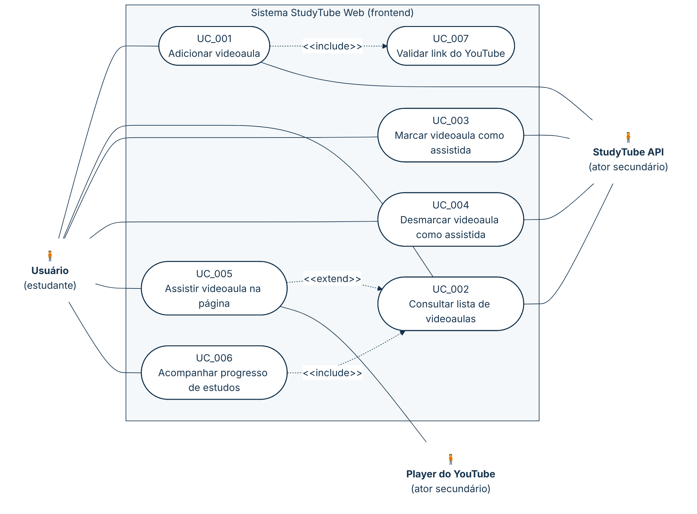

# 🔄 4.2 Diagrama e especificação de casos de uso

> **PADRÃO DA DISCIPLINA** Nome com verbo no infinitivo; IDs `UC_001`; passos começam por quem executa ("Usuário …", "Sistema …"); descrevem **o que** acontece, não **como** (sem "clica"); fluxo principal sem condicionais; FA = escolha do usuário; FE = validação que o usuário não escolheu; todo FA/FE indica para onde vai. Aqui "Sistema" é a **interface web**. Os códigos são os mesmos do backend.

## 4.2.1 Diagrama de casos de uso — visão da interface web

*Figura 1 — Diagrama de casos de uso do StudyTube Web. Escopo: frontend. v1.0 · 21/10/2026 · Daniele Benfica. Ref.: RFW01–RFW08. Fonte: [`img/diagrama-casos-de-uso.mmd`](img/diagrama-casos-de-uso.mmd).*

**Leitura do diagrama.** Adicionar uma videoaula **sempre** valida o link (UC_001 `<<include>>` UC_007). Acompanhar o progresso **sempre** depende da lista carregada (UC_006 `<<include>>` UC_002). Assistir é uma ação **opcional** a partir da lista (UC_005 `<<extend>>` UC_002): o estudante pode ver a lista sem assistir nada. UC_008 (Obter metadados do vídeo) acontece só dentro da API e está no backend.

| ID | Caso de uso | Requisitos da tela | Requisitos da API | Estado |
|---|---|---|---|---|
| UC_001 | Adicionar videoaula | RFW01, RFW07 | RF01, RF05 | ✅ |
| UC_002 | Consultar lista de videoaulas | RFW03, RFW07, RFW08 | RF02 | ✅ |
| UC_003 | Marcar videoaula como assistida | RFW04, RFW07 | RF03 | ✅ |
| UC_004 | Desmarcar videoaula como assistida | RFW04, RFW07 | RF04 | ✅ |
| UC_005 | Assistir videoaula na página | RFW05 | — | ✅ |
| UC_006 | Acompanhar progresso de estudos | RFW06 | — | ✅ |
| UC_007 | Validar link do YouTube (incluído) | RFW02 | RF05 | ✅ |

## 4.2.2 UC_001 – Adicionar videoaula

**Formato casual.** O usuário cola o link de um vídeo do YouTube e pede para adicionar. A tela confere se o link é do YouTube, envia para a API e mostra a nova videoaula no topo da lista, limpando o campo. Se algo der errado, a tela mostra a mensagem e mantém o link para correção.

| NOME DO CASO DE USO | UC_001 – Adicionar videoaula |
|---|---|
| ATORES | Usuário (estudante); StudyTube API (secundário) |
| PRÉ-CONDIÇÕES | A página do StudyTube está aberta. |
| PÓS-CONDIÇÕES | A videoaula aparece no topo da lista, o campo do link está vazio e o progresso foi recalculado. |
| FLUXO PRINCIPAL | 1) Usuário indica que deseja adicionar uma videoaula. 2) Sistema apresenta o campo "Cole aqui o link do YouTube 💕" e a opção "Adicionar ✨". 3) Usuário informa o link do vídeo. 4) Usuário solicita a inclusão. 5) Sistema valida que o link é do YouTube, conforme UC_007 (RNW01). 6) Sistema envia o link à StudyTube API. 7) Sistema recebe os dados da videoaula cadastrada (título, canal, miniatura e duração). 8) Sistema apresenta a videoaula no topo da lista e limpa o campo do link (RNW03). 9) Sistema atualiza o indicador de progresso (UC_006). Fim do caso de uso. |
| FLUXOS ALTERNATIVOS | **FA_01 – Informar link curto** 3.a.1) Usuário informa o link no formato `https://youtu.be/{id}`. Retorna ao passo 4 do fluxo principal. |
| FLUXOS DE EXCEÇÃO | **FE_01 – Campo vazio (RNW02)** 4.a.1) Sistema mantém a opção "Adicionar ✨" indisponível enquanto o campo estiver vazio. Retorna ao passo 3 do fluxo principal.  **FE_02 – Link não é do YouTube (RNW01)** 5.a.1) Sistema verifica que o link não é do YouTube. 5.a.2) Sistema apresenta o aviso "Esse link não é do YouTube 🥺" e mantém o link no campo. Retorna ao passo 3 do fluxo principal.  **FE_03 – API recusa o vídeo (RN01–RN05, RN09 da API)** 7.a.1) Sistema recebe a recusa da API com uma mensagem. 7.a.2) Sistema apresenta a mensagem recebida, por exemplo "Este vídeo já está na sua lista.", "Vídeo não encontrado no YouTube.", "URL inválida." ou "Não é uma URL de vídeo do YouTube.", e mantém o link no campo (RNW04). Retorna ao passo 3 do fluxo principal.  **FE_04 – Erro da API sem mensagem** 7.b.1) Sistema recebe um erro sem mensagem de negócio (por exemplo, falha da API ao consultar o YouTube). 7.b.2) Sistema apresenta "Algo deu errado 😢" e mantém o link no campo (RNW04). Retorna ao passo 3 do fluxo principal.  **FE_05 – API indisponível** 6.a.1) Sistema não consegue se comunicar com a API. 6.a.2) Sistema apresenta a mensagem de erro de rede do navegador (no Chrome, "Failed to fetch") e mantém o link no campo. Retorna ao passo 3 do fluxo principal. |

## 4.2.3 UC_002 – Consultar lista de videoaulas

**Formato casual.** Ao abrir a página, a tela busca a lista na API e mostra um card por videoaula, das mais recentes para as mais antigas, junto com o progresso.

| NOME DO CASO DE USO | UC_002 – Consultar lista de videoaulas |
|---|---|
| ATORES | Usuário (estudante); StudyTube API (secundário) |
| PRÉ-CONDIÇÕES | Nenhuma. |
| PÓS-CONDIÇÕES | A lista de videoaulas está visível. |
| FLUXO PRINCIPAL | 1) Usuário acessa a página do StudyTube. 2) Sistema solicita a lista de videoaulas à StudyTube API. 3) Sistema apresenta um card por videoaula, das mais recentes para as mais antigas, com miniatura, título, "canal • duração" (RNW08) e as opções "▶ Assistir" e "✔ Já assisti" ou "↩ Desmarcar". 4) Sistema apresenta o progresso, conforme UC_006. Fim do caso de uso. |
| FLUXOS ALTERNATIVOS | Não há. |
| FLUXOS DE EXCEÇÃO | **FE_01 – Lista vazia (RNW07)** 3.a.1) Sistema verifica que não há videoaulas. 3.a.2) Sistema apresenta "Nenhum vídeo ainda... cole seu link aqui! 🐰" e não apresenta o indicador de progresso. Fim do caso de uso.  **FE_02 – API indisponível (RNW05)** 2.a.1) Sistema não consegue obter a lista. 2.a.2) Sistema apresenta "Não consegui falar com a API. Ela está rodando? 🥺". Fim do caso de uso. |

## 4.2.4 UC_003 – Marcar videoaula como assistida

**Formato casual.** O usuário indica que já assistiu uma videoaula; a tela registra na API, destaca o card e atualiza o progresso.

| NOME DO CASO DE USO | UC_003 – Marcar videoaula como assistida |
|---|---|
| ATORES | Usuário (estudante); StudyTube API (secundário) |
| PRÉ-CONDIÇÕES | A videoaula aparece na lista como não assistida. |
| PÓS-CONDIÇÕES | O card está destacado como assistido, com a opção "↩ Desmarcar", e o progresso foi atualizado. |
| FLUXO PRINCIPAL | 1) Usuário indica que já assistiu a videoaula ("✔ Já assisti"). 2) Sistema envia a marcação à StudyTube API. 3) Sistema recebe a videoaula atualizada. 4) Sistema destaca o card como assistido e troca a opção para "↩ Desmarcar". 5) Sistema atualiza o indicador de progresso (UC_006). Fim do caso de uso. |
| FLUXOS ALTERNATIVOS | Não há. |
| FLUXOS DE EXCEÇÃO | **FE_01 – API recusa a marcação (RN06 da API)** 3.a.1) Sistema recebe a recusa da API. 3.a.2) Sistema apresenta a mensagem recebida (por exemplo, "Este vídeo já foi marcado como assistido.") ou "Algo deu errado 😢" quando não há mensagem (por exemplo, videoaula não encontrada), sem alterar o card. Fim do caso de uso.  **FE_02 – API indisponível** 2.a.1) Sistema não consegue se comunicar com a API. 2.a.2) Sistema apresenta a mensagem de erro de rede do navegador, sem alterar o card. Fim do caso de uso. |

## 4.2.5 UC_004 – Desmarcar videoaula como assistida

| NOME DO CASO DE USO | UC_004 – Desmarcar videoaula como assistida |
|---|---|
| ATORES | Usuário (estudante); StudyTube API (secundário) |
| PRÉ-CONDIÇÕES | A videoaula aparece na lista como assistida. |
| PÓS-CONDIÇÕES | O card volta ao visual normal, com a opção "✔ Já assisti", e o progresso foi atualizado. |
| FLUXO PRINCIPAL | 1) Usuário indica que deseja desmarcar a videoaula ("↩ Desmarcar"). 2) Sistema envia a desmarcação à StudyTube API. 3) Sistema recebe a videoaula atualizada. 4) Sistema retira o destaque do card e troca a opção para "✔ Já assisti". 5) Sistema atualiza o indicador de progresso (UC_006). Fim do caso de uso. |
| FLUXOS ALTERNATIVOS | Não há. |
| FLUXOS DE EXCEÇÃO | **FE_01 – API recusa a desmarcação** 3.a.1) Sistema recebe um erro da API (por exemplo, videoaula não encontrada). 3.a.2) Sistema apresenta "Algo deu errado 😢", sem alterar o card. Fim do caso de uso.  **FE_02 – API indisponível** 2.a.1) Sistema não consegue se comunicar com a API. 2.a.2) Sistema apresenta a mensagem de erro de rede do navegador, sem alterar o card. Fim do caso de uso. |

## 4.2.6 UC_005 – Assistir videoaula na página

**Formato casual.** O usuário escolhe uma videoaula da lista e ela começa a tocar num player acima da lista, sem sair do StudyTube. Ele pode trocar de vídeo ou fechar o player.

| NOME DO CASO DE USO | UC_005 – Assistir videoaula na página |
|---|---|
| ATORES | Usuário (estudante); Player do YouTube (secundário) |
| PRÉ-CONDIÇÕES | A lista tem pelo menos uma videoaula. |
| PÓS-CONDIÇÕES | O player está fechado. O estado de assistida **não** muda (RNW09). |
| FLUXO PRINCIPAL | 1) Usuário indica que deseja assistir a uma videoaula ("▶ Assistir" ou a miniatura). 2) Sistema apresenta o player do YouTube acima da lista, com reprodução automática. 3) Usuário assiste à videoaula. 4) Usuário indica que deseja fechar o player ("Fechar player ✖"). 5) Sistema oculta o player. Fim do caso de uso. |
| FLUXOS ALTERNATIVOS | **FA_01 – Assistir outra videoaula** 3.a.1) Usuário indica que deseja assistir a outra videoaula da lista. 3.a.2) Sistema substitui o vídeo do player pela videoaula escolhida. Retorna ao passo 3 do fluxo principal.  **FA_02 – Marcar como assistida durante a reprodução** 3.b.1) Usuário indica que já assistiu a videoaula, conforme UC_003. Retorna ao passo 3 do fluxo principal. |
| FLUXOS DE EXCEÇÃO | Não há regra de negócio validada pela tela. Indisponibilidades do próprio vídeo são exibidas pelo player do YouTube. |

## 4.2.7 UC_006 – Acompanhar progresso de estudos

| NOME DO CASO DE USO | UC_006 – Acompanhar progresso de estudos |
|---|---|
| ATORES | Usuário (estudante) |
| PRÉ-CONDIÇÕES | A lista foi carregada, conforme UC_002. |
| PÓS-CONDIÇÕES | O usuário vê quantas videoaulas já assistiu. |
| FLUXO PRINCIPAL | 1) Usuário consulta a lista de videoaulas (UC_002). 2) Sistema conta as videoaulas assistidas. 3) Sistema apresenta "X de Y assistidos 🌸". Fim do caso de uso. |
| FLUXOS ALTERNATIVOS | Não há. |
| FLUXOS DE EXCEÇÃO | **FE_01 – Lista vazia (RNW07)** 2.a.1) Sistema verifica que não há videoaulas. 2.a.2) Sistema não apresenta o indicador. Fim do caso de uso. |

## 4.2.8 UC_007 – Validar link do YouTube (incluído por UC_001)

| NOME DO CASO DE USO | UC_007 – Validar link do YouTube |
|---|---|
| ATORES | — (executado pelo Sistema dentro do UC_001) |
| PRÉ-CONDIÇÕES | O usuário solicitou a inclusão de um link. |
| PÓS-CONDIÇÕES | O link está liberado para envio à API. |
| FLUXO PRINCIPAL | 1) Sistema remove os espaços das pontas do link. 2) Sistema verifica que o link começa por um endereço do YouTube (`youtube.com/` ou `youtu.be/`, com `http(s)://` e `www.` opcionais) (RNW01). Retorna ao passo 6 do UC_001. |
| FLUXOS ALTERNATIVOS | Não há. |
| FLUXOS DE EXCEÇÃO | **FE_01 – Link não é do YouTube:** 2.a.1) Sistema apresenta "Esse link não é do YouTube 🥺". Retorna ao passo 3 do UC_001. A validação completa (formato do ID, caminho `watch`/`embed`/`shorts`) é feita pela API (UC_007 do backend). |

---

## 📚 Referências

<!-- REFS-INICIO -->
- COCKBURN, Alistair. **Escrevendo casos de uso eficazes**: um guia prático para desenvolvedores de software. Tradução: Roberto Vedoato. Porto Alegre: Bookman, 2005. (Ciência da computação). ISBN 9788536304571.
- PRESSMAN, Roger S.; MAXIM, Bruce. **Engenharia de software**: uma abordagem profissional. Tradução: Francisco Araújo da Costa. 9. ed. Porto Alegre: McGraw-Hill, 2021. E-book. ISBN 9786558040118.
- REINEHR, Sheila. **Engenharia de requisitos**. Porto Alegre: SAGAH, 2020. E-book. (Engenharia de software). ISBN 9786556900674.
- EASY AGILE. **Use cases vs. user stories**: how they differ and when to use them. 8 jun. 2021. Disponível em: https://www.easyagile.com/blog/use-cases-vs-user-stories/. Acesso em: 21 out. 2026.
- PUCKETT, Dan. **Será que os casos de uso têm lugar no Scrum?** Tradução: Marcelo Costa. InfoQ Brasil, 19 nov. 2010. Disponível em: https://www.infoq.com/br/news/2010/11/use-cases-in-scrum/. Acesso em: 21 out. 2026.
- Lista completa (normas ISO/IEC/IEEE, UML, C4, OpenAPI e material da disciplina): [referencias.md](referencias.md).
<!-- REFS-FIM -->
