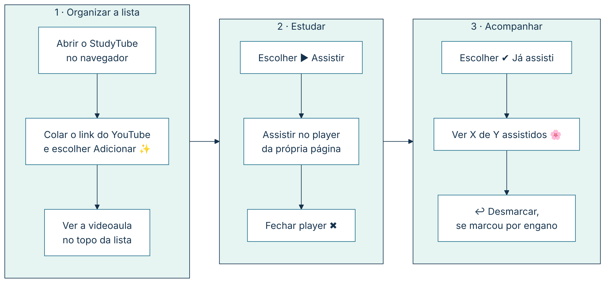
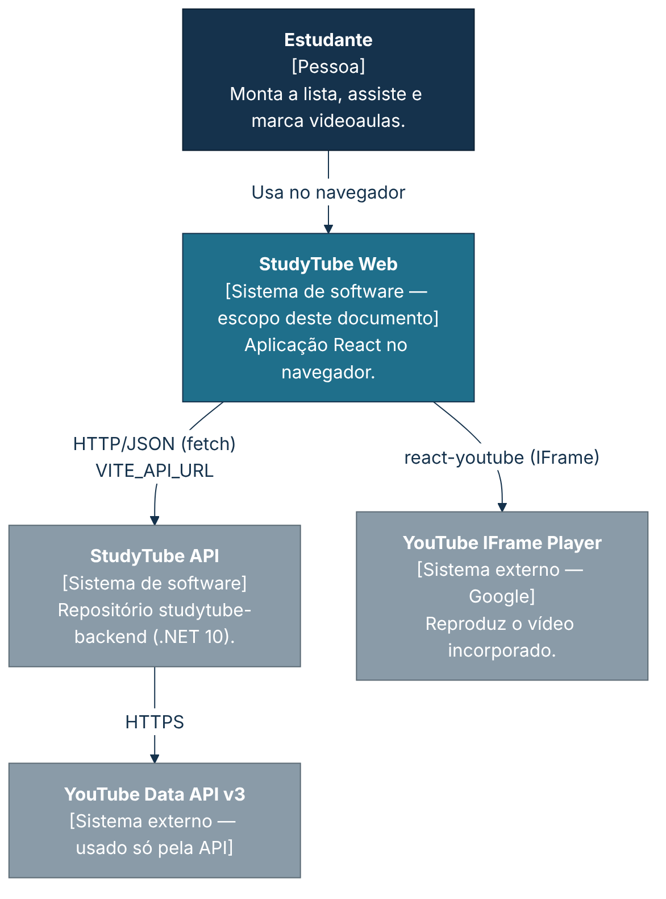
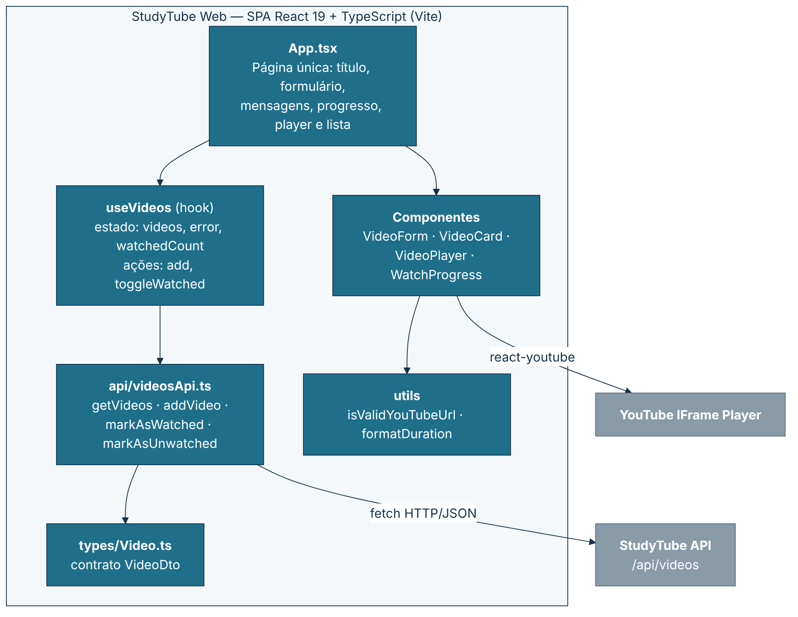
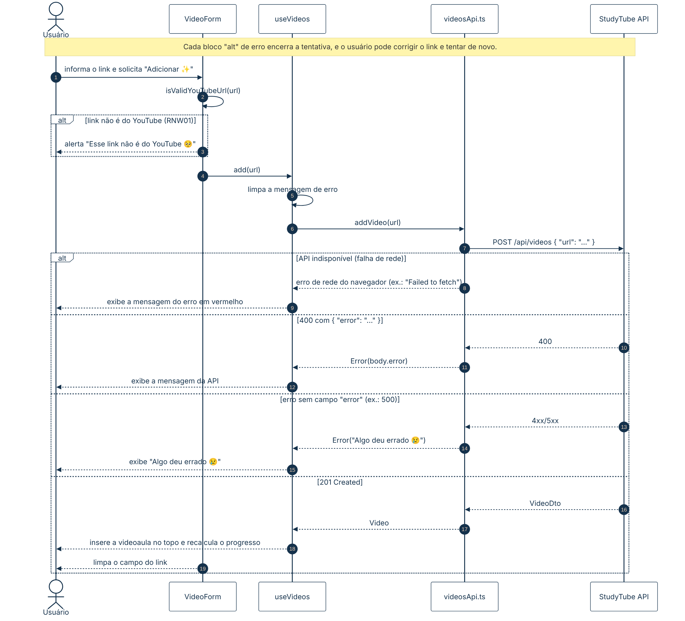
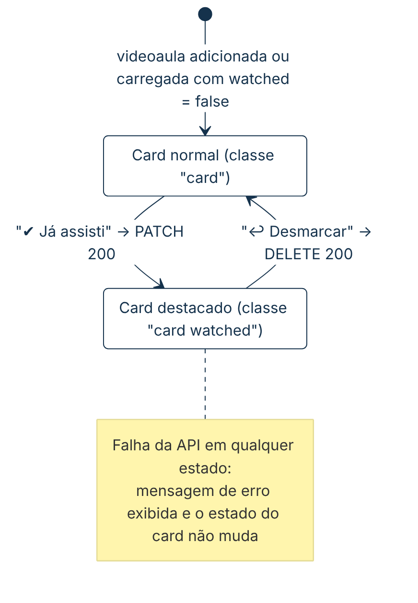
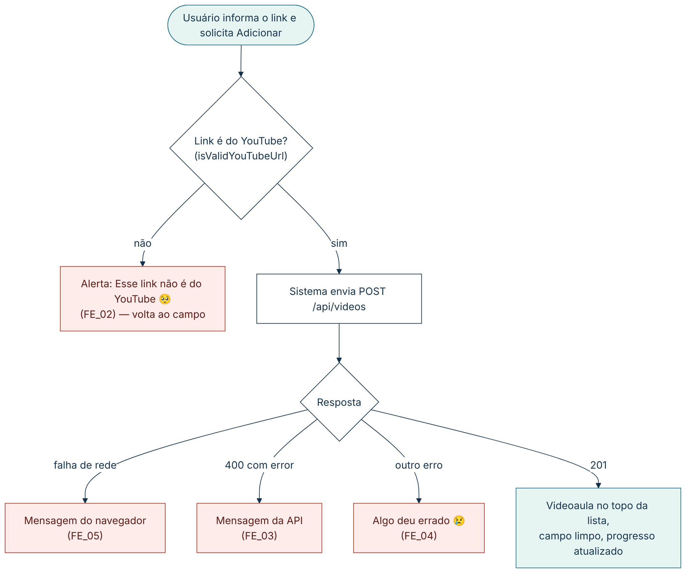
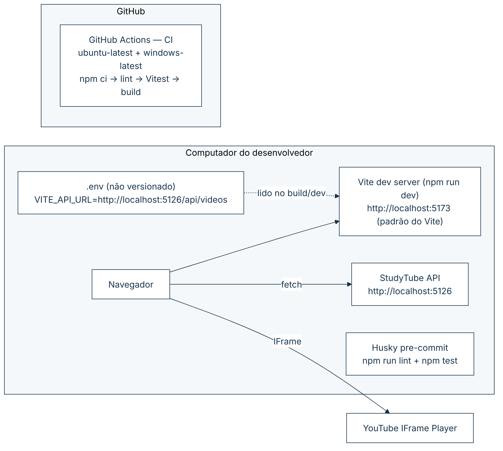

# 🧩 5. Diagramas e fluxos ponta a ponta

| Representação | Pergunta que responde | Aplicação no frontend |
|---|---|---|
| Diagrama de casos de uso (UML) | Quem usa a tela e para quê? | ✅ [4.2](04.2-casos-de-uso.md) |
| Jornada de usuário | O que o estudante faz na Web? | ✅ 5.1 |
| Fluxo funcional (estilo BPMN simplificado) | Quais decisões e exceções existem? | ✅ 5.6 (Adicionar videoaula) |
| C4 Context | Com quem a Web conversa? | ✅ 5.2 |
| C4 Container / componentes | Como a SPA está dividida? | ✅ 5.3 |
| UML Sequence | Ordem das chamadas na inclusão | ✅ 5.4 |
| UML State Machine | Estados do card de videoaula | ✅ 5.5 |
| Deployment | Onde roda e como é verificado | ✅ 5.7 |

**Regras gráficas.** Toda figura tem título, escopo, versão/data, responsável e referência. Fonte Mermaid (`.mmd`) ao lado do PNG em `docs/img`; para atualizar: `npx @mermaid-js/mermaid-cli -i arquivo.mmd -o arquivo.png`.

## 5.1 Jornada do usuário

*Figura 2 — Jornada do estudante no StudyTube Web (três etapas; os desvios de erro estão em 5.6 e no UC_001). v1.0 · 21/10/2026 · Daniele Benfica. Ref.: UC_001–UC_006. Fonte: [`img/jornada.mmd`](img/jornada.mmd).*

## 5.2 C4 Context

*Figura 3 — C4 Context do StudyTube Web. v1.0 · 21/10/2026 · Daniele Benfica. Ref.: RFW01–RFW07, RNFW05. Fonte: [`img/c4-contexto.mmd`](img/c4-contexto.mmd).*

## 5.3 C4 Container / componentes da SPA

*Figura 4 — Componentes da SPA React. v1.0 · 21/10/2026 · Daniele Benfica. Ref.: [3.3](03-arquitetura-da-informacao.md). Fonte: [`img/c4-container.mmd`](img/c4-container.mmd).*

## 5.4 UML Sequence — adicionar videoaula pela tela

*Figura 5 — Sequência da inclusão de videoaula pela tela, com validação local e erros da API. v1.0 · 21/10/2026 · Daniele Benfica. Ref.: UC_001, UC_007, FLOW-WEB-001. Fonte: [`img/sequencia-adicionar.mmd`](img/sequencia-adicionar.mmd).*

## 5.5 UML State Machine — card da videoaula

*Figura 6 — Estados do card: não assistida ⇄ assistida. O estado só muda depois da resposta `200` da API. v1.0 · 21/10/2026 · Daniele Benfica. Ref.: UC_003, UC_004, RFW04. Fonte: [`img/estados-card.mmd`](img/estados-card.mmd).*

## 5.6 Fluxo funcional — adicionar videoaula

*Figura 7 — Decisões e exceções do UC_001 na tela. v1.0 · 21/10/2026 · Daniele Benfica. Ref.: UC_001 FE_02–FE_05. Fonte: [`img/fluxo-adicionar.mmd`](img/fluxo-adicionar.mmd).*

## 5.7 Deployment

*Figura 8 — Ambiente local, Husky e CI. v1.0 · 21/10/2026 · Daniele Benfica. Ref.: RNFW01, RNFW03, RNFW04, [4.6](04.6-procedimento-operacional.md). Fonte: [`img/implantacao.mmd`](img/implantacao.mmd).*

## 5.8 Regra de granularidade

Cada fluxo ponta a ponta tem uma página central no [Anexo B](anexo-b-fluxos-ponta-a-ponta.md). Detalhes do servidor (validação completa, YouTube, banco) ficam na documentação do backend e são apenas referenciados.

---

## 📚 Referências

<!-- REFS-INICIO -->
- COCKBURN, Alistair. **Escrevendo casos de uso eficazes**: um guia prático para desenvolvedores de software. Tradução: Roberto Vedoato. Porto Alegre: Bookman, 2005. (Ciência da computação). ISBN 9788536304571.
- PRESSMAN, Roger S.; MAXIM, Bruce. **Engenharia de software**: uma abordagem profissional. Tradução: Francisco Araújo da Costa. 9. ed. Porto Alegre: McGraw-Hill, 2021. E-book. ISBN 9786558040118.
- REINEHR, Sheila. **Engenharia de requisitos**. Porto Alegre: SAGAH, 2020. E-book. (Engenharia de software). ISBN 9786556900674.
- EASY AGILE. **Use cases vs. user stories**: how they differ and when to use them. 8 jun. 2021. Disponível em: https://www.easyagile.com/blog/use-cases-vs-user-stories/. Acesso em: 21 out. 2026.
- PUCKETT, Dan. **Será que os casos de uso têm lugar no Scrum?** Tradução: Marcelo Costa. InfoQ Brasil, 19 nov. 2010. Disponível em: https://www.infoq.com/br/news/2010/11/use-cases-in-scrum/. Acesso em: 21 out. 2026.
- Lista completa (normas ISO/IEC/IEEE, UML, C4, OpenAPI e material da disciplina): [referencias.md](referencias.md).
<!-- REFS-FIM -->
