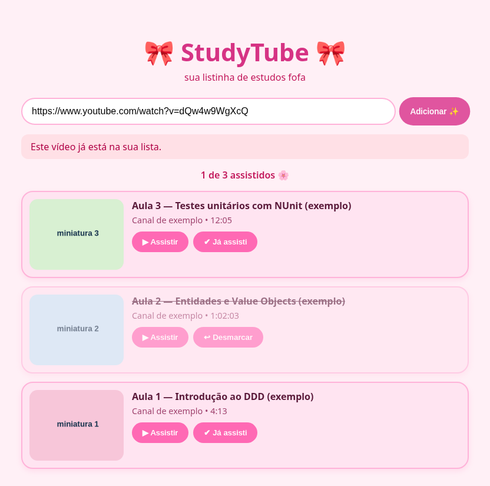
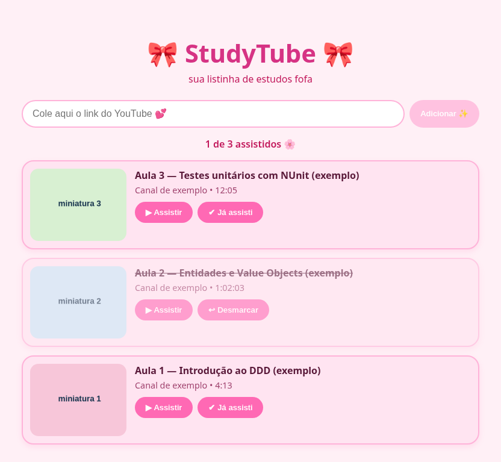
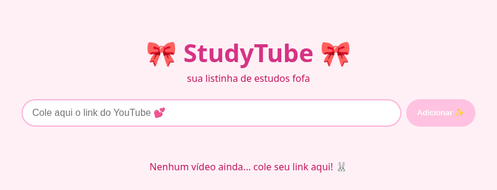
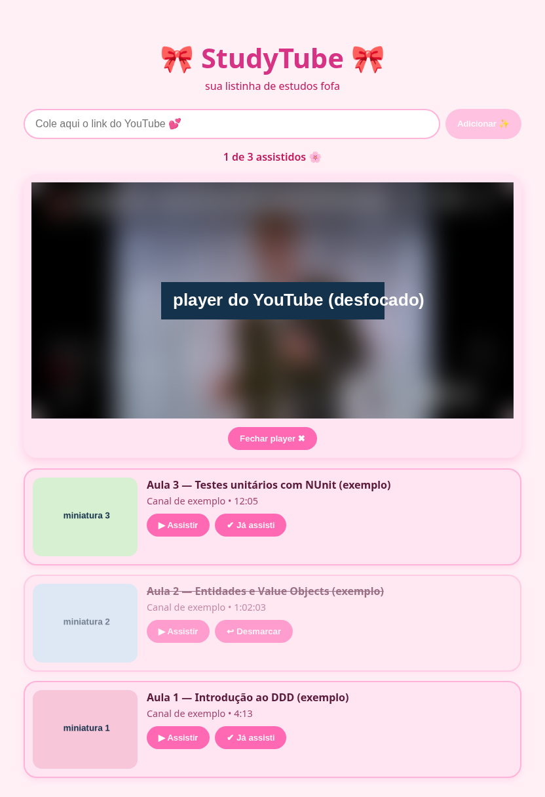
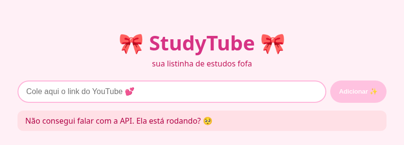

# 📘 Anexo F — Manual do usuário da Web

| Seção | Conteúdo |
|---|---|
| F.1 Finalidade e audiência | Para o estudante que quer organizar videoaulas do YouTube. Não precisa saber programar. Pré-requisito: o StudyTube (tela e API) rodando no computador. |
| F.2 Acesso e primeiros passos | Abra no navegador o endereço mostrado pelo `npm run dev` (normalmente `http://localhost:5173`). Não há login. |
| F.3 Tarefas principais | MAN-FE-01 a MAN-FE-04. |
| F.4 Estados e resultados | Card normal = ainda não assistida; card destacado com "↩ Desmarcar" = assistida. Contador "X de Y assistidos 🌸". |
| F.5 Problemas frequentes | MAN-FE-05. |
| F.6 Suporte / privacidade | O StudyTube guarda só os dados públicos do vídeo (título, canal, miniatura, duração) no seu computador. Não informe dados pessoais no campo do link. |
| F.7 Versão e atualização | Compatível com `studytube-frontend` @ `93fedb7` e `studytube-backend` @ `382c379`. Owner: Daniele Benfica. |

> **SOBRE AS IMAGENS** As capturas foram feitas em 21/10/2026 com a tela real do StudyTube e **dados de exemplo** (títulos e miniaturas fictícios). O vídeo dentro do player foi desfocado.

## MAN-FE-01 — Adicionar uma videoaula

1. No YouTube, copie o link do vídeo (por exemplo `https://www.youtube.com/watch?v=...` ou `https://youtu.be/...`).
2. No StudyTube, cole o link no campo **"Cole aqui o link do YouTube 💕"**.
3. Escolha **"Adicionar ✨"**. (A opção fica apagada enquanto o campo estiver vazio.)
4. A videoaula aparece **no topo da lista** com miniatura, título, canal e duração, e o campo fica vazio.

Se o link não for do YouTube, aparece o aviso **"Esse link não é do YouTube 🥺"**. Se o vídeo já estiver na lista, aparece em vermelho **"Este vídeo já está na sua lista."**:

*Figura 9 — Mensagem da API exibida na tela (UC_001 FE_03). Dados de exemplo.*

## MAN-FE-02 — Ver a lista e o progresso

Ao abrir a página, você vê um card por videoaula, das mais recentes para as mais antigas, e o contador de progresso acima da lista.

*Figura 10 — Lista com três videoaulas, uma assistida ("1 de 3 assistidos 🌸"). Dados de exemplo.*

Quando ainda não há videoaulas, a tela convida a começar:

*Figura 11 — Lista vazia: "Nenhum vídeo ainda... cole seu link aqui! 🐰".*

## MAN-FE-03 — Marcar e desmarcar como assistida

1. No card da videoaula, escolha **"✔ Já assisti"**.
2. O card fica destacado, a opção muda para **"↩ Desmarcar"** e o contador aumenta.
3. Marcou por engano? Escolha **"↩ Desmarcar"** e o card volta ao normal.

## MAN-FE-04 — Assistir sem sair da página

1. Escolha **"▶ Assistir"** (ou a miniatura) no card.
2. O player aparece acima da lista e o vídeo começa sozinho.
3. Para trocar de vídeo, escolha "▶ Assistir" em outro card.
4. Para fechar, escolha **"Fechar player ✖"**.

Assistir **não** marca a videoaula como assistida — use "✔ Já assisti" quando terminar.

*Figura 12 — Player incorporado acima da lista (conteúdo do vídeo desfocado). Dados de exemplo.*

## MAN-FE-05 — Problemas frequentes

| O que aparece | Causa provável | O que fazer |
|---|---|---|
| "Não consegui falar com a API. Ela está rodando? 🥺" | A API está desligada. | Ligue a API e recarregue a página. |
| "Esse link não é do YouTube 🥺" | O link não começa com `youtube.com` ou `youtu.be`. | Copie de novo o link do vídeo no YouTube. |
| "URL inválida." | O link foi colado sem `https://`. | Cole o link completo, começando com `https://`. |
| "Não é uma URL de vídeo do YouTube." | O link é de um canal, playlist ou página que não é vídeo. | Abra o vídeo e copie o link dele. |
| "Este vídeo já está na sua lista." | O vídeo já foi adicionado. | Procure o vídeo na lista. |
| "Vídeo não encontrado no YouTube." | O vídeo foi removido, é privado ou o link está errado. | Confira o link no YouTube. |
| "Algo deu errado 😢" | Falha da API (por exemplo, ao consultar o YouTube). | Tente de novo mais tarde; se continuar, verifique a API. |
| "Failed to fetch" (ou outra mensagem técnica) | A API caiu enquanto você usava a página. | Ligue a API e tente de novo. |

*Figura 13 — Aviso de API desligada ao abrir a página (UC_002 FE_02).*

> **CRITÉRIO DO MANUAL** O estudante deve conseguir adicionar, assistir, marcar e desmarcar videoaulas e entender cada mensagem de erro usando só este anexo.

---

## 📚 Referências

<!-- REFS-INICIO -->
- COCKBURN, Alistair. **Escrevendo casos de uso eficazes**: um guia prático para desenvolvedores de software. Tradução: Roberto Vedoato. Porto Alegre: Bookman, 2005. (Ciência da computação). ISBN 9788536304571.
- PRESSMAN, Roger S.; MAXIM, Bruce. **Engenharia de software**: uma abordagem profissional. Tradução: Francisco Araújo da Costa. 9. ed. Porto Alegre: McGraw-Hill, 2021. E-book. ISBN 9786558040118.
- REINEHR, Sheila. **Engenharia de requisitos**. Porto Alegre: SAGAH, 2020. E-book. (Engenharia de software). ISBN 9786556900674.
- EASY AGILE. **Use cases vs. user stories**: how they differ and when to use them. 8 jun. 2021. Disponível em: https://www.easyagile.com/blog/use-cases-vs-user-stories/. Acesso em: 21 out. 2026.
- PUCKETT, Dan. **Será que os casos de uso têm lugar no Scrum?** Tradução: Marcelo Costa. InfoQ Brasil, 19 nov. 2010. Disponível em: https://www.infoq.com/br/news/2010/11/use-cases-in-scrum/. Acesso em: 21 out. 2026.
- Lista completa (normas ISO/IEC/IEEE, UML, C4, OpenAPI e material da disciplina): [referencias.md](referencias.md).
<!-- REFS-FIM -->
